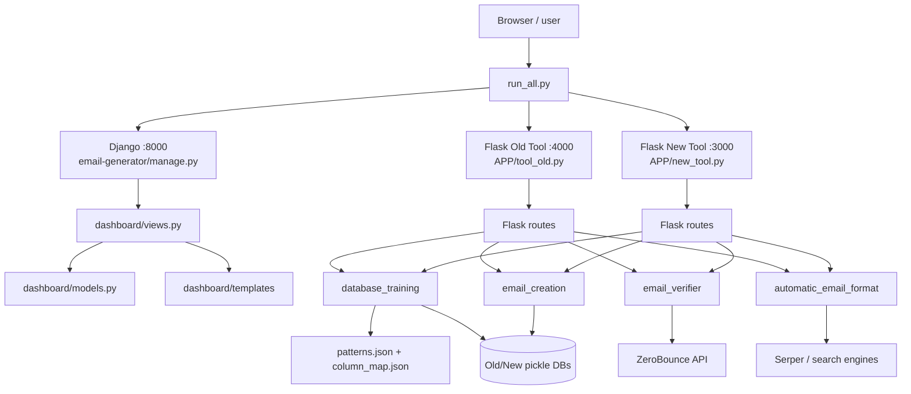

# EmailTool-2026 — Architecture and File/Function Reference

## 1. How to read this document

- **Active** means the file is explicitly launched by `run_all.py` or imported by an active entry point.
- **Legacy / snapshot** means a similarly named alternative, backup or notebook is present but is not selected by `run_all.py`.
- **Used by** lists callers that can be established from the source tree. If no direct caller is visible, it is marked as a callable utility/standalone module. A function may also be called by a route through an imported module.
- Line numbers refer to the supplied ZIP revision and can change after edits.

## 2. System architecture



### Launcher-to-service connection

`run_all.py` defines `BASE_DIR`, `DJANGO_DIR` and `APP_DIR`. It calls `install_requirements()` for `email-generator/requirements.txt` if present, then launches three child processes:

| Child command | Working directory | Source selected |
|---|---|---|
| `python manage.py runserver 0.0.0.0:8000` | `email-generator/` | Django project |
| `python tool_old.py` | `APP/` | `APP/tool_old.py` |
| `python new_tool.py` | `APP/` | `APP/new_tool.py` |

The archive does not contain `email-generator/requirements.txt`; this is a packaging/configuration gap.

## 3. Flask routes and feature call graph

Both `APP/tool_old.py` and `APP/new_tool.py` define substantially parallel Flask endpoints. Their implementation details and configured data paths should be treated separately.

| HTTP route | Flask function | Main downstream function/module | Purpose |
|---|---|---|---|
| `GET /` | `dashboard()` | `render_template(...)` | Render Flask dashboard |
| `GET /database-counts` | `database_count()` | PKL read/count helpers | Return database counts |
| `GET /list-files` | `list_files()` | filesystem traversal | List available output files |
| `GET /download-file` | `download_file()` | Flask file response | Download a selected file |
| `POST /train-database` | `train_database()` | `db_pipeline.process_single_file()` / `process_folder()` | Train company pattern database from upload |
| `POST /upload` | `upload_file()` | `helper.csv_excel_loader.file_load()` and route-specific processing | Upload/load a source file |
| `POST /update-database-manually` | `update_file()` | `database_training.update_db_manually.update_pickle()` | Manually merge a CSV into PKL |
| `POST /email` | `create_email()` | `email_creation.create_emails.email_creator_app()` | Generate candidate emails |
| `POST /emailverify` | `verify_email()` | `email_verifier.email_verifier.verify_app()` | Verify emails using ZeroBounce |
| `POST /automatic-email` | `automatic_email()` | `automatic_email_runner.run_automatic_email()` | Search for email formats/candidates |
| `POST /clear_logs` | `clear_logs()` | filesystem log cleanup | Clear application logs |

Additional Old Tool-only/older route: `APP/old_tool.py` has `split_file()`; that file is not the one launched by `run_all.py`.

### Shared Flask helper functions

Present in both `tool_old.py` and `new_tool.py`:

| Function | Purpose |
|---|---|
| `create_pickle_if_missing(file_path, data)` | Creates an initial pickle file when absent. |
| `database_count()` | Loads/counts database records and returns route response. |
| `list_files()` | Lists files available to the UI. |
| `download_file()` | Serves a selected file to the browser. |
| `log_query_result(log_file, query, results, error=None)` | Appends query results/errors to a log. |
| `make_backup_db(main_file_path, backup_path)` | Makes a copy of a database file before modification. |
| `dashboard()` | Renders the Flask dashboard page. |
| `train_database()` | Handles single-file or folder database-training uploads. |
| `upload_file()` | Handles the general file-upload workflow. |
| `update_file()` | Handles manual database update upload. |
| `create_email()` | Handles email-generation request. |
| `verify_email()` | Handles email-verification request. |
| `automatic_email()` | Handles automatic email-discovery request. |
| `clear_logs()` | Clears configured log files. |

`tool_old.py` definitions start around lines 83–498; `new_tool.py` around lines 83–501. The New Tool file contains two consecutive `@app.route('/database-counts')` decorators before `database_count()`; verify/remove the redundant registration during maintenance.

## 4. Database training package — `APP/database_training/`

### 4.1 Main module: `db_pipeline.py`

This is the current shared training pipeline imported by both active Flask services.

| Function | What it does | Used by |
|---|---|---|
| `_load_json(path)` | Reads JSON configuration as UTF-8. | `_load_patterns()`, `_load_column_map()` |
| `_load_patterns()` | Loads `patterns`, `aliases`, `invalid` from `patterns.json`. | Module initialization; pattern matching |
| `_load_column_map()` | Loads canonical-column aliases from `column_map.json`. | Module initialization |
| `_normalise_columns(df)` | Maps incoming headings to canonical names. | `_process_chunk()` / `read_file()` |
| `_split_contact_name(df)` | Derives first/last name when only contact name is supplied. | Input normalization path |
| `_check_mandatory(df)` | Validates mandatory company, first name, last name and email fields. | Cleaning/reading path |
| `_clean_dataframe(df)` | Removes unusable rows and normalizes string values. | `_process_chunk()` |
| `_process_chunk(chunk, chunk_idx)` | Normalizes and cleans one input chunk. | `read_file()` |
| `read_file(file_path)` | Reads supported CSV/Excel input and returns normalized data. | `process_single_file()` |
| `_apply_template(template, fn, ln)` | Substitutes name tokens into an email local-part template. | `_identify_pattern()` |
| `_identify_pattern(fn, ln, email_local)` | Finds which configured template matches the email local-part. | `extract_patterns()` |
| `_extract_domain(email)` | Extracts the domain from an email address. | `extract_patterns()` |
| `extract_patterns(df)` | Determines email pattern per row, groups by company/pattern and returns extracted pattern data. | `process_single_file()` |
| `process_single_file(input_file, output_folder, pkl_path, emit_fn=None)` | Full single-file flow: read → extract → save dated CSV → update PKL; returns status dictionary. | `tool_old.train_database()`, `new_tool.train_database()` |
| `_emit(emit_fn, msg, kind='info')` | Sends optional progress messages to caller. | `process_single_file()`, `process_folder()` |
| `_already_processed(stem, existing_csv_names)` | Checks whether a dated output CSV already exists for a source stem. | `process_folder()` |
| `process_folder(input_folder, output_folder, pkl_path, emit_fn=None)` | Processes supported files in a folder and returns processed/skipped/failed summary. | `tool_old.train_database()`, `new_tool.train_database()` |
| `_load_pickle(pkl_path)` | Loads existing company-pattern dictionary. | `update_pickle()` |
| `_save_pickle(pkl_path, data)` | Writes company-pattern dictionary to pickle. | `update_pickle()` |
| `update_pickle(pkl_path, csv_path)` | Merges extracted company/pattern CSV into selected pickle DB and returns counts. | `process_single_file()`; manual update module is separate |

**Input contract implemented in module comments/code:** company, first name, last name and email; flexible header aliases in `column_map.json`; CSV and Excel inputs; Excel reading combines up to the first five sheets. Check exact extension handling in `read_file()` before relying on XLS support in every code path.

**Output:** dated `*_output.csv` containing company/pattern information and a pickle dictionary mapping normalized company key to pattern string.

### 4.2 Other database-training files

| File | Functions | What it does | Used by / status |
|---|---|---|---|
| `column_map.json` | JSON configuration | Lists accepted column-header variations for canonical fields. | Loaded by `db_pipeline._load_column_map()`; also used by its normalizer. |
| `patterns.json` | JSON configuration | Pattern templates, aliases and invalid templates. | Loaded by `db_pipeline._load_patterns()`. |
| `database_process_mutifile.py` | `process_files_and_save_output(input_folder, output_folder)` | Earlier multi-file processing implementation using `email_format_extracter.get_email_formats()`. | Legacy pipeline; imported by `APP/old_tool.py`, not the active launcher target. |
| `database_process_single_file.py` | `process_single_file(input_file, output_folder, output_pkl_path)` | Earlier one-file extraction and PKL update wrapper. | Legacy `APP/old_tool.py` and `APP/full_pipeline_code.py`; active `tool_old.py`/`new_tool.py` instead import `db_pipeline`. |
| `email_format_extracter.py` | `get_domain(row)`, `identify_email_pattern(row)`, `db_email_extracter(file_path)`, `get_email_formats(file_path)`, `process_single_file(input_file, output_folder)` | Earlier extraction implementation based on row/domain/pattern analysis. | Used by the two legacy database-process modules. |
| `merger_for_pckl.py` | `update_pkl_with_csv(file_name, output_pkl_path)`, `update_pkl_with_folder_csv(folder_path, output_pkl_path)` | Merges extracted CSV data into pickle database, including folder operation. | Used by legacy `database_process_single_file.py` and `APP/full_pipeline_code.py`. |
| `reader.py` | `process_file(file_path, chunk_size)`, `reader(file_path)` | Earlier file-reading/cleaning utility for company/contact data. | Standalone/legacy reader; no direct import from active launcher-selected Flask apps. |
| `update_db_manually.py` | `process_csv(file_path)`, `update_pickle(pickle_file, new_csv_file)` | Reads/normalizes a CSV and updates a pickle DB. | Imported by both active Flask apps for `/update-database-manually`; also used in older flows. |
| `database_training/email_tool.ipynb` | Notebook cells | Interactive development/testing of database training. | Not executed by launcher. |

## 5. Email creation package — `APP/email_creation/`

| File | Function | What it does | Used by |
|---|---|---|---|
| `create_emails.py` | `normalize_pattern(pattern)` | Normalizes a stored pattern representation for generation. | `create_emails2()` |
| `create_emails.py` | `create_emails2(row, email_patterns)` | Builds candidate email address(es) for a contact row from company pattern data. | `email_creator_app()` |
| `create_emails.py` | `email_creator_app(file, email_patterns)` | Reads uploaded contacts, looks up company patterns and generates output. | `tool_old.create_email()`, `new_tool.create_email()` |
| `reader_email.py` | `process_file(file_path)` | Loads CSV/Excel, standardizes contact columns and derives first/last names where possible. | `reader()` |
| `reader_email.py` | `reader(file_path)` | Returns the selected/cleaned contact columns used by email creation. | `create_emails.py` |
| `get_email_flags.py` | `extract_emails(text)`, `extract_text(value)`, `extract_domain(email_pattern)`, `similarity_score(company, domain)`, `get_flags(concatenated_df, col_name)` | Derives email/domain and company-domain quality flags. | Utility module; inspect imports in notebooks/other scripts before changing. |
| `create_emails copy.py` | `create_emails2(row, email_patterns)`, `email_creator_app(file, email_patterns)` | Snapshot of an earlier email-generation implementation. | Not imported by active Flask entry points. |
| `reader copy.py` | No top-level function in AST inventory | Tiny reader snapshot. | Not used by active entry points. |
| `email_tool.ipynb` | Notebook cells | Interactive email creation experiments. | Not executed by launcher. |

## 6. Email verification package — `APP/email_verifier/`

| File | Function | What it does | Used by |
|---|---|---|---|
| `email_verifier.py` | `get_email_status(email, api_key)` | Calls ZeroBounce validate endpoint for one address and returns its status (or `Error` if response lacks status). | `get_verified_data()` |
| `email_verifier.py` | `get_verified_data(file, api_key)` | Loads input and applies validation to the `Email` column. Current code slices to first two rows before validation. | `verify_app()` |
| `email_verifier.py` | `verify_app(file, api_key)` | Public wrapper for verification. | `tool_old.verify_email()`, `new_tool.verify_email()` |
| `csv_excel_loader.py` | `file_load(file_path)` | Reads an uploaded CSV/Excel file. | `email_verifier.py` |
| `emailVerifyer.ipynb` | Notebook cells | Interactive verification tests. | Not executed by launcher. |

## 7. Automatic discovery/scraping package — `APP/automatic_email_format/`

This folder contains multiple overlapping approaches. The active route in both active Flask services calls `automatic_email_runner.run_automatic_email()`. Other scripts are alternative runners, helpers, backup versions or experiments.

### 7.1 Active route path

```text
Flask /automatic-email
  └─ automatic_email_runner.run_automatic_email()
      ├─ discover_with_serper()
      │   ├─ serper_search()
      │   ├─ convert_to_old_format()
      │   ├─ extract_emails() / extract_email_format()
      │   └─ get_final_email()
      │       └─ get_best_email.get_final_email()
      └─ scarpper_manager.get_email_pattern() [imported helper]
```

`automatic_email_runner.py` also imports `get_email_pattern` from `scarpper_manager.py`. The runner emits progress through the Socket.IO object passed by the Flask route.

### 7.2 File and function inventory

| File | Functions | Responsibility / connection |
|---|---|---|
| `automatic_email_runner.py` | `log(message)`, `serper_search(query, num_results)`, `convert_to_old_format(serper_data)`, `extract_emails(snippet)`, `extract_email_format(snippet)`, `extract_domain(email)`, `similarity_score(company, domain)`, `flatten_email_matches(email_data, company_name)`, `get_final_email(old_format_results, company)`, `discover_with_serper(companies)`, `run_automatic_email(input_file, output_dir, socketio, max_companies)` | Main active automatic discovery workflow called by both Flask `/automatic-email` routes. Reads companies, queries Serper, extracts/compares candidates, selects results and reports progress. |
| `get_best_email.py` | `similarity_score(company, domain)`, `select_best_email(data_list)`, `get_selected_email(data)`, `extract_results_lists(file_path)`, `run(result_dict1)`, `get_final_email(results, company)`, `update_pickle_file(old_pickle_path, new_data_path, key_column, value_column)` | Candidate scoring/selection, parsing prior result files and optional pickle update. `get_final_email()` is imported by the active runner. |
| `scarpper_manager.py` | `log_query_result(log_file, query, results, error)`, `get_email_pattern(email)`, `extract_email_format(snippet)`, `extract_emails(snippet)`, `select_best_row(group)`, `get_email_patterns_only(yesterday_data, name)`, `createCSV(data, name, batch)`, `process_csv(filename)`, `update_pickle(pickle_file, new_csv_file)`, `scrapper_manager(...)` | Batch search/scrape manager with query logs, pattern extraction, CSV batches, PKL update and checkpoint support. Active runner imports `get_email_pattern`; separate `scrapper_run.py` calls `scrapper_manager()`. |
| `web_email_scrapper_multiEngine.py` | `fetch_startpage_results(query, num_results)`, `fetch_bing_results(query, num_results)`, `fetch_yahoo_results(query, num_results)`, `fetch_google_results(query, proxy, num_results)`, `fetch_results_with_retry(query, num_results, engines)`, `distribute_queries_across_engines(queries, batch_size)`, `get_email_from_snippet(data)`, `update_pickle_file(old_pickle_path, new_pickle_path, backup_path)`, `get_latest_log_file(log_path)`, `recover_from_logs(log_file, output_txt_file, checkpoint_file)`, `recover_with_latest(log_dir, output_txt_file, checkpoint_file)` | Multi-search-engine retrieval, query distribution, extraction and recovery/checkpoint utilities. Imported by both Flask apps for recovery/update/search helpers; `scarpper_manager.py` imports engine fetch functions. |
| `process_scrapped_data.py` | `fetch_google_results(query, company_name, proxy, num_results)`, `extract_domain(email)`, `similarity_score(company, domain)`, `evaluate_email_matches(email_data, company_name)`, `flatten_email_matches(email_data, company_name)`, `select_best_email(email_data)`, `extract_emails(snippet)`, `extract_email_format(snippet)`, `process_run(company, query, proxy)` | Parses scraped search results, extracts addresses/patterns, evaluates company-domain relevance and selects a candidate. Imported by `scarpper_manager.py` and both Flask apps. |
| `get_email_flags.py` | `extract_emails(text)`, `extract_text(value)`, `extract_domain(email_pattern)`, `similarity_score(company, domain)`, `get_flags(concatenated_df, col_name)` | Flags/quality indicators for extracted email patterns. Used by `scarpper_manager.py`. |
| `scrapper_data_process.py` | `get_email_pattern(EMAIL)`, `extract_email(snippet)`, `extract_accuracy(snippet)`, `extract_website(url)`, `get_domain(email)`, `extract_text(text)`, `extract_emails(text)`, `createCSV(data, name)`, `get_emailPattern_flags(df)` | Earlier/general scraping-result cleanup and feature extraction utilities. No direct import from the active Flask entry points was found. |
| `scrapper_run.py` | `app_run(csv_file, db_pickle_file_path, new_pickle_file_path, scrapper_output)` | Wrapper to start batch `scrapper_manager()` workflow. Standalone runner, not launched by `run_all.py`. |
| `serper_email_module.py` | `log(message, log_file)`, `read_input_file(file_path)`, `save_output_file(df, input_file, output_dir)`, `serper_search(query, api_key, num_results)`, `convert_to_old_format(serper_data)`, `extract_emails(text)`, `extract_domain(email)`, `similarity_score(company, domain)`, `select_best_email(old_results, company)`, `get_final_pattern(serper_data, company)`, `run_serper_with_multiple_keys(input_file, output_dir, api_keys, rows_per_key)` | Separate Serper-based batch processor supporting multiple API keys. No direct import from active Flask route file in this archive; treat as a standalone/alternate workflow. |
| `scarpper_manager_backup.py` | Same named functions as `scarpper_manager.py` | Backup snapshot of scraper manager; not imported by active Flask files. |
| `Email_flags.ipynb`, `PickleFileadjustments*.ipynb`, `WebScrap*.ipynb` | Notebook cells | Research, experiments and historical workflows. Not started by `run_all.py`. |
| `multienginehh.numbers` | Spreadsheet | Supporting data/artifact; no Python import found. |

**Naming note:** The source uses the spelling `scarpper` in filenames and imports. Preserve that spelling unless performing a coordinated rename across every import.

## 8. Shared helper package — `APP/helper/`

| File | Function | What it does | Used by |
|---|---|---|---|
| `csv_excel_loader.py` | `file_load(file_path)` | Reads CSV/Excel data into a DataFrame. | Imported by both active Flask apps and by other modules using `helper.csv_excel_loader`. |
| `__init__.py` | — | Marks `helper` as a Python package. | Python import system. |

There is a separate `APP/email_verifier/csv_excel_loader.py` with its own `file_load()` implementation. Do not assume the two loaders are identical; compare them before consolidating.

## 9. Django project — `email-generator/`

### 9.1 Django request flow

```text
Browser
  └─ email_generator/urls.py
      ├─ /admin/ → Django admin
      └─ include(dashboard.urls)
          └─ dashboard/views.py
              ├─ dashboard/models.py (SQLite ORM)
              ├─ dashboard/utils.py
              ├─ dashboard/forms.py (admin form)
              └─ dashboard/templates/*.html
```

### 9.2 Project files

| File | Function/class | What it does / used by |
|---|---|---|
| `manage.py` | `main()` | Django command-line entry point; launched by root `run_all.py` using `runserver`. |
| `email_generator/settings.py` | Settings module | Configures installed apps, middleware, SQLite DB, templates, media/static, timezone and security settings. Used by all Django commands/WSGI/ASGI. |
| `email_generator/urls.py` | `urlpatterns` | Routes `/admin/` to admin and root paths to `dashboard.urls`. |
| `email_generator/wsgi.py` | WSGI application | Production WSGI entry point. |
| `email_generator/asgi.py` | ASGI application | ASGI entry point. |
| `dashboard/apps.py` | `DashboardConfig` | Django app configuration. |
| `dashboard/models.py` | `uploaded_sheet_path(instance, filename)` | Upload path for original uploaded sheets; used by `UploadSheet`. |
| `dashboard/models.py` | `UploadSheet` model | Stores uploaded spreadsheet metadata/file. Used by views/admin. |
| `dashboard/models.py` | `sanitize_username(username)` | Produces safe username path component. Used by model upload-path functions. |
| `dashboard/models.py` | `uploaded_missing_data_file_path(instance, filename)` | Builds upload path for missing-data files. |
| `dashboard/models.py` | `MissingDataFile` model | Stores missing-data file and associated metadata. Used by views/admin/forms. |
| `dashboard/models.py` | `assigned_missing_data_file_path(instance, filename)` | Builds storage path for an assigned work file. |
| `dashboard/models.py` | `skipped_rows_file_path(instance, filename)` | Builds storage path for skipped rows. |
| `dashboard/models.py` | `WorkAssignment` model | Stores work allocation, assigned file/range and skipped-row data. Used by views/admin. |
| `dashboard/views.py` | `home(request)` | Renders dashboard/home page; URL-mapped. |
| `dashboard/views.py` | `upload_sheet(request)` | Handles spreadsheet upload; URL-mapped. |
| `dashboard/views.py` | `UploadSheetActions` class | Class-based actions for uploaded sheets; URL-mapped via `.as_view()`. |
| `dashboard/views.py` | `missing_data(request)` | Renders missing-data workflow; URL-mapped. |
| `dashboard/views.py` | `get_paginated_data(request)` | Returns paginated missing-data rows; URL-mapped. |
| `dashboard/views.py` | `save_edited_data(request)` | Saves user-edited row data; URL-mapped. |
| `dashboard/views.py` | `skip_row(request)` | Marks/skips a row in the missing-data workflow; URL-mapped. |
| `dashboard/urls.py` | `urlpatterns` | Maps dashboard URLs to the views above and Django auth login/logout views. |
| `dashboard/utils.py` | `sanitize_username(username)` | Utility for safe user-specific paths. |
| `dashboard/utils.py` | `create_directory(name)` | Creates a configured directory. |
| `dashboard/utils.py` | `generate_email(file)` | Email-generation utility for a file; inspect its implementation before assuming it shares the Flask email-generation pipeline. |
| `dashboard/forms.py` | `MissingDataFileAdminForm` | Admin form for `MissingDataFile`; used by admin registration. |
| `dashboard/admin.py` | `UploadSheetAdmin`, `MissingDataFileAdmin`, `WorkAssignmentAdmin` | Configures Django admin display/actions for the three models. |
| `dashboard/tests.py` | — | Django test module; currently no custom top-level test case/function was detected. |
| `dashboard/migrations/0001_initial.py`–`0008_*.py` | Migration operations | Database schema history for the dashboard models. Run through Django migration commands; do not edit old migrations casually. |
| `db.sqlite3` | SQLite database | Local Django persistence. It is not the Flask company-pattern PKL database. |
| `Dockerfile`, `docker-compose.yml`, `nginx.conf` | Deployment configuration | Container/reverse-proxy configuration artifacts. Review paths and service definitions before using; root `run_all.py` does not invoke Docker. |
| `Readme.md` | Existing Django subproject README | Django-folder documentation; this new root README/architecture document covers the complete repository. |

## 10. Flask templates and static assets

| File | Role | Active usage evidence |
|---|---|---|
| `APP/templates/dashboard.html` | Main Flask dashboard template candidate. | Confirmed/likely selected by `render_template()`; inspect exact `dashboard()` call in each Flask app before replacing. |
| `APP/templates/dashboard_old.html` | Older dashboard layout. | Legacy template; use only if referenced by a route. |
| `APP/templates/dashboadBackup.html` | Backup template (filename spelling is `dashboad`). | Backup; not assumed active. |
| `APP/templates/dashboard copy.html` | Copied dashboard template. | Snapshot; not assumed active. |
| `APP/static/style.css` | Flask styles. | Served by Flask static handling when template references it. |
| `email-generator/dashboard/templates/base.html` | Shared Django base layout. | Extended by Django templates. |
| `home.html` | Django home page. | Rendered by home view. |
| `login.html` | Django login screen. | Auth route/template. |
| `upload_sheet.html` | Django sheet upload screen. | Upload view. |
| `missing_data.html` | Django missing-data screen. | Missing-data view. |

## 11. Other top-level/legacy files

| File | Functions | Role / usage |
|---|---|---|
| `APP/old_tool.py` | `dashboard`, `upload_file`, `update_file`, `create_email`, `verify_email`, `automatic_email`, `split_file`, `clear_logs` | Older Flask implementation. It is not the file launched by root `run_all.py`; launcher uses `tool_old.py`. |
| `APP/new_tool copy 2.py` | Flask route/helper functions analogous to New Tool | Snapshot/backup. Not launched by root `run_all.py`. |
| `APP/full_pipeline_code.py` | Imports and combines multi-file/single-file DB processing, PKL merger/manual updater and email creation | Standalone orchestration script/older pipeline; no invocation from active launcher found. |
| `APP/old_tool_file.py` (repository parent `APP/`, outside `Email_Tool-2026/`) | Separate legacy file | Outside the active project root; not imported/launched by `Email_Tool-2026/run_all.py`. |
| `APP/test-notebook.ipynb`, `APP/file_processing.ipynb`, `APP/mergerpkl.ipynb` | Notebook cells | Exploratory or historical work; not launched by `run_all.py`. |
| `APP/extra/xtrafile/testfile.py` | Top-level pickle import/test script | Test artifact; not part of active request flow. |
| `.gitignore` | Git ignore rules | Repository housekeeping. |

## 12. Important data stores and boundaries

| Store | Used for | Not the same as |
|---|---|---|
| Old Tool PKL (path configured in `tool_old.py`) | Company → email pattern database for Old Tool | Django `db.sqlite3` |
| New Tool PKL (path configured in `new_tool.py`) | Company → email pattern database for New Tool | Old Tool PKL |
| Extracted `*_output.csv` files | Intermediate company/pattern evidence produced by `db_pipeline` | Original uploaded spreadsheet |
| Django `db.sqlite3` | Django users, uploaded sheets, missing-data/work assignments | Flask company-pattern PKL |
| Uploaded source files | Input data for training/generation/verification | Generated output files |

Always confirm exact configured paths in the active Flask file before moving or backing up data. Do not merge Old and New Tool databases unless that is an explicit operation with a backup and validation plan.

## 13. Source-derived issues and documentation caveats

These are observable from the supplied source, not assumptions about production state:

1. **Missing dependency manifest:** root `run_all.py` checks `email-generator/requirements.txt`, but it is absent from this ZIP.
2. **Duplicate route registration:** `APP/new_tool.py` has two consecutive `/database-counts` route decorators before the same `database_count()` function.
3. **Verification row limit:** `APP/email_verifier/email_verifier.py:get_verified_data()` assigns `df = processed_data[:2]`, so the current implementation validates only the first two rows.
4. **Django development/security settings:** `settings.py` has `DEBUG = True` and a literal `SECRET_KEY`; do not deploy as-is.
5. **Flask debug/development configuration:** active Flask startup sections should be checked before production exposure.
6. **Launcher lifecycle:** it reports services as started immediately after `Popen()` and terminates without waiting for child exit/health checks.
7. **Legacy/active naming:** launcher runs `tool_old.py`, not `old_tool.py`; it runs `new_tool.py`, not `new_tool copy 2.py`.
8. **Many notebook and backup files:** these are not automatically part of runtime. Avoid treating every file in the folder as active code.
9. **Email verification network calls:** ZeroBounce request handling should include timeout, HTTP error handling and API-key protection before large-scale use.
10. **Pickle trust boundary:** never load a pickle supplied by an untrusted user/source.

## 14. Suggested change-control rules

1. Make changes first in the launcher-selected modules only after confirming the intended behavior.
2. Before modifying a PKL updater, back up the exact Old/New PKL separately.
3. Add tests for normalization, pattern matching, tie-breaking and merge semantics before bulk training.
4. Keep Old Tool and New Tool output, upload, log and database paths distinct.
5. Update this document whenever a route, function, file, configuration key or data-flow dependency changes.
6. For every function marked standalone/legacy, verify its actual caller before deleting it.

## 15. Quick lookup: active call chain by feature

| Feature | Start | Core path |
|---|---|---|
| Start all services | `run_all.py` | Django `manage.py` + `tool_old.py` + `new_tool.py` |
| Train one file | Flask `/train-database` | `train_database()` → `db_pipeline.process_single_file()` → `read_file()` → `extract_patterns()` → `update_pickle()` |
| Train folder | Flask `/train-database` | `train_database()` → `db_pipeline.process_folder()` → per-file `process_single_file()` |
| Manual PKL update | Flask `/update-database-manually` | `update_file()` → `update_db_manually.update_pickle()` |
| Generate email | Flask `/email` | `create_email()` → `email_creator_app()` → `reader_email.reader()` → `create_emails2()` |
| Verify email | Flask `/emailverify` | `verify_email()` → `verify_app()` → `get_verified_data()` → `get_email_status()` → ZeroBounce |
| Automatic discovery | Flask `/automatic-email` | `automatic_email()` → `run_automatic_email()` → Serper/search parsing and candidate selection |
| Django sheet upload | Django dashboard URL | `upload_sheet()` → `UploadSheet` model + template |
| Django missing data | Django dashboard URL | `missing_data()` / `get_paginated_data()` / `save_edited_data()` / `skip_row()` → models + templates |
